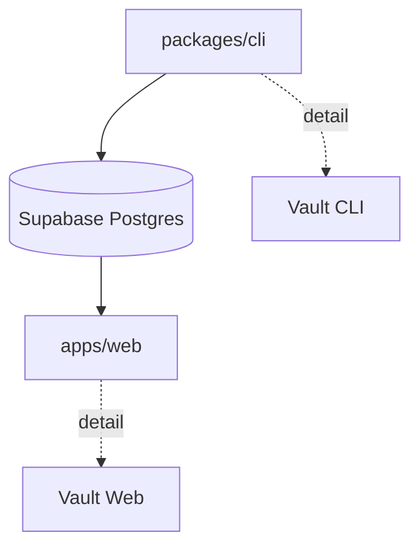

# SonicPoint System Map

> [!info] Apa ini?
> Canonical map. Vault Root memahami SonicPoint sebagai **satu sistem**. Detail CLI/Web hanya pointer, bukan duplikat.

SonicPoint v2.0.0 = monorepo unified (`sonicpoint`, private). Gabungan `sonic-dashboard` + `sonic-point` lama.

```
SonicPoint/
  apps/web/       # Next.js dashboard, public report viewer
  packages/cli/   # sonic-point CLI, scan Express + test + publish
  supabase/       # migrations source of truth + seed.sql
```

Workspace (`pnpm-workspace.yaml`): `apps/*`, `packages/*`. Package manager `pnpm@12.4.1`.

## Komponen

| Bagian | Peran | Detail di |
|---|---|---|
| [[01-glossary]] | Definisi istilah: project, session, endpoint, schema | vault ini |
| [[02-dataflow]] | Alur data CLI → Supabase → Web | vault ini |
| [[03-contracts]] | Kontrak DB + RLS + API implisit (canonical) | vault ini |
| [[04-decisions]] | Keputusan arsitektur + alasan | vault ini |
| [[05-constraints]] | Batasan + UNKNOWN | vault ini |
| [[06-todo]] | TODO global | vault ini |
| CLI deep-dive | Command → pipeline scan/run/report | Vault CLI: `packages/cli/knowledge/00-cli-map.md` |
| Web deep-dive | Pages → queries → render | Vault Web: `apps/web/knowledge/00-web-map.md` |



> [!warning] Anti-duplikasi
> File ini tidak berisi detail implementasi CLI/Web. Kalau butuh detail, ikuti pointer ke vault masing-masing. Kontrak penuh hanya di [[03-contracts]].

## AI guide

- Sebelum ubah apa pun: baca [[02-dataflow]] + [[03-contracts]] + [[04-decisions]].
- Sebelum ubah CLI: buka Vault CLI.
- Sebelum ubah Web: buka Vault Web.
- Sebelum ubah schema: baca `source of truth` di [[03-contracts]] — ubah SQL + mirror types + CLI + Web bersamaan.
