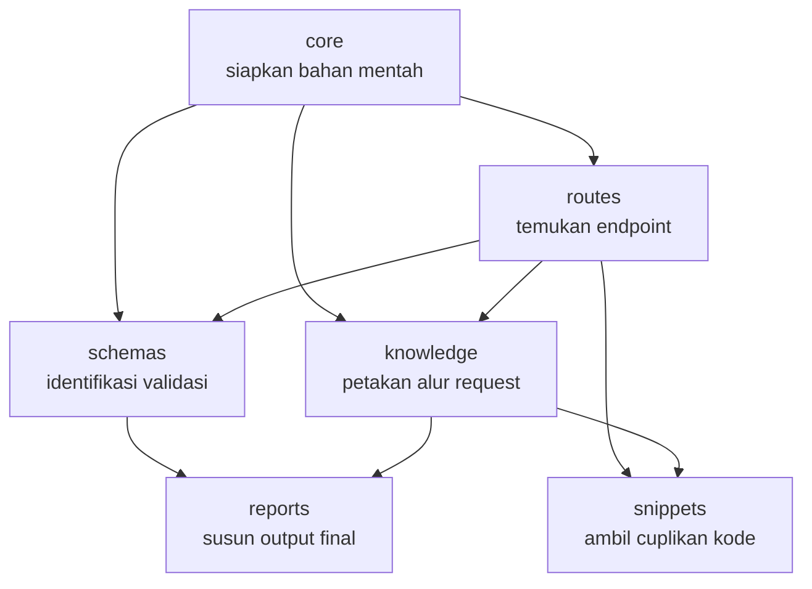

# `src/scan/` — Scanner Codebase

Folder ini bertanggung jawab untuk **membaca struktur backend Express milik pengguna** tanpa menjalankan server atau menggunakan AI untuk menebak secara manual.
Tujuan utamanya adalah menghasilkan pemahaman yang jelas tentang:

- endpoint API yang aktif
- validasi yang diterapkan pada tiap request
- alur request dari controller menuju service, model, dan dependency lain
- konteks kode yang relevan untuk analisis lebih lanjut

Semua proses dilakukan secara otomatis dan berbasis analisis kode statis.

## Tujuan modul

`src/scan/` memecah proses analisis menjadi beberapa tahapan yang terpisah:

1. Mengumpulkan file sumber dari proyek.
2. Menganalisis struktur kode menjadi representasi yang bisa diproses mesin.
3. Menemukan route dan middleware yang relevan.
4. Mengidentifikasi skema validasi serta hubungan endpoint dengan datanya.
5. Menyusun alur request secara ringkas dan konsisten.
6. Menyediakan output yang siap dibaca di terminal atau digunakan oleh modul lain.

## Alur kerja

- `core/` menyiapkan data mentah dari proyek, seperti file-file yang ditemukan dan hasil parsing AST.
- `routes/` menangani pencarian endpoint dan penyusunan pohon route yang lengkap.
- `schemas/` mengumpulkan aturan validasi dan mencocokkannya dengan endpoint yang sesuai.
- `knowledge/` membangun pemahaman tentang call flow, symbol, dan dependency antar modul.
- `snippets/` mengambil cuplikan kode yang relevan dari lokasi tertentu.
- `reports/` mengubah semua hasil tersebut menjadi format yang rapi dan mudah dibaca.

## Struktur folder

| Folder | Fungsi utama |
|---|---|
| `core/` | Mengumpulkan file kode dan mempersiapkan data untuk diproses lebih lanjut |
| `routes/` | Mendeteksi endpoint, middleware, dan struktur path API |
| `schemas/` | Menganalisis skema input serta validasi yang berlaku pada tiap route |
| `knowledge/` | Memetakan alur request dari entry point sampai komponen terkait |
| `snippets/` | Mengambil potongan kode spesifik untuk konfirmasi atau melihat detail implementasi |
| `reports/` | Menyusun laporan akhir ke format yang siap dibaca manusia |

## File utama

| File | Deskripsi |
|---|---|
| `core/findFiles.ts` | Mencari file sumber yang akan dianalisis. |
| `core/parseAst.ts` | Menparse file kode menjadi struktur yang bisa dipahami mesin; file yang rusak akan diabaikan dengan aman. |
| `routes/collectRoutes.ts` | Mengumpulkan route, middleware, dan controller dari file yang diproses. |
| `routes/resolveTree.ts` | Menggabungkan path yang terpecah menjadi URL lengkap. |
| `routes/scanEndpoints.ts` | Menentukan endpoint aktif yang ada di project. |
| `schemas/scanSchemas.ts` | Mencari aturan validasi dan struktur payload yang dibutuhkan tiap endpoint. |
| `schemas/buildApiGraph.ts` | Menghubungkan endpoint dengan skema validasinya. |
| `knowledge/indexSymbols.ts` | Merekam symbol utama dan lokasi definisinya dalam project. |
| `knowledge/buildKnowledge.ts` | Menyusun peta alur request dari entry point hingga dependency yang relevan. |
| `snippets/collectSnippets.ts` | Mengambil cuplikan kode di sekitar titik relevan untuk kebutuhan inspeksi. |
| `reports/formatSchema.ts` | Menyusun laporan skema menjadi output yang lebih mudah dibaca. |
| `reports/formatContext.ts` | Menyusun ringkasan alur request dan status pemetaan yang berhasil dibuat. |

## Output yang dihasilkan

Modul ini dirancang untuk menjawab pertanyaan-pertanyaan berikut:

- API apa saja yang tersedia?
- Endpoint mana yang memiliki middleware atau validasi khusus?
- Controller apa yang menangani tiap route?
- Service atau model apa yang dipanggil oleh request tersebut?
- Apakah ada bagian yang belum dapat dipetakan dengan jelas?

Hasilnya biasanya berupa laporan terminal yang ringkas namun cukup informatif untuk proses debugging, review kode, dan pemahaman arsitektur.

> Untuk detail teknis lebih lanjut, lihat [knowledge/01-scan.md](../../knowledge/01-scan.md).
