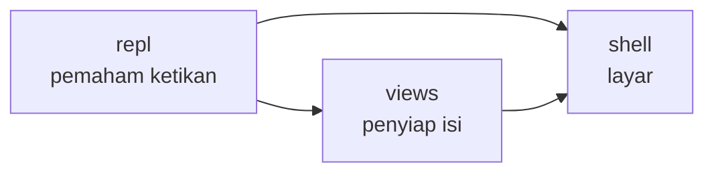

# `src/tui/` — Mode Interaktif di Terminal

Folder ini gunanya untuk **mode interaktif**: jalankan `sonic-point` tanpa argumen,
muncul prompt `›` tempat kamu mengetik perintah seperti `/scan`, `/schema`, `/context`.
Isinya hanya urusan tampilan + interaksi — semua jawaban tetap diambil dari `scan/`.

## Hubungan antar folder

- `shell` adalah layarnya: menampilkan banner, kolom ketikan, daftar saran, dan hasil.
- `repl` adalah yang memahami ketikan: mengenali perintah, meneruskannya ke bagian yang tepat, dan menyimpan riwayat hasil.
- `views` adalah yang menyiapkan isi tiap perintah sebelum ditampilkan di layar.

## Folder dan fungsinya

| Folder | Fungsinya untuk apa |
|---|---|
| `shell/` | Menampilkan semuanya di layar terminal |
| `repl/` | Memahami ketikan user dan mengatur alurnya |
| `views/` | Menyiapkan isi tampilan untuk tiap perintah |

## File dan fungsinya

| File | Deskripsi + fungsi untuk apa |
|---|---|
| `shell/runTui.ts` | Pintu masuk. Menyalakan mode interaktif (menolak halus bila terminal tak mendukung). |
| `shell/ReplApp.tsx` | Layar utama. Menjawab: kolom ketik, daftar saran, dan riwayat hasil. |
| `shell/Home.tsx` | Papan pembuka. Menampilkan nama project, tips awal, dan status kesiapan. |
| `repl/commandRegistry.ts` | Daftar perintah. Mencatat perintah apa saja yang dikenal dan cara membacanya. |
| `repl/dispatchCommands.ts` | Pengatur lalu lintas. Meneruskan tiap perintah ke bagian yang tepat dan menangani error dengan pesan ramah. |
| `repl/transcript.ts` | Pencatat riwayat. Menyimpan hasil-hasil sebelumnya supaya bisa di-scroll. |
| `views/scanView.ts` | Penyiap isi `/scan`. Menjawab: API apa saja, dikelompokkan per file. |
| `views/schemaView.ts` | Penyiap isi `/schema`. Menjawab: tiap API butuh data apa (wajib vs opsional). |
| `views/contextView.ts` | Penyiap isi `/context`. Menjawab: request lewat mana saja + apa yang belum ketemu. |

> Perintah yang tersedia: `/scan` `/schema` `/context` `/clear` `/quit` (siap),
> `/test` `/report` `/config` (segera hadir).
> Detail tampilan: [knowledge/07-tui-repl.md](../../knowledge/07-tui-repl.md).
